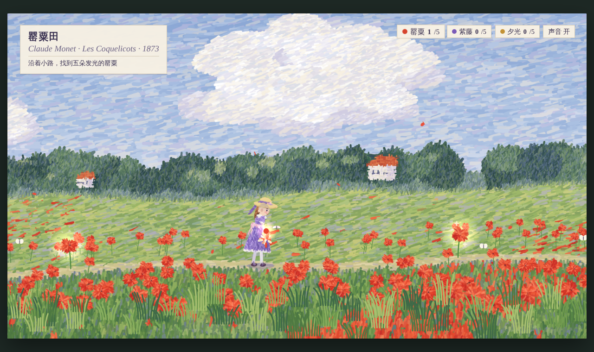
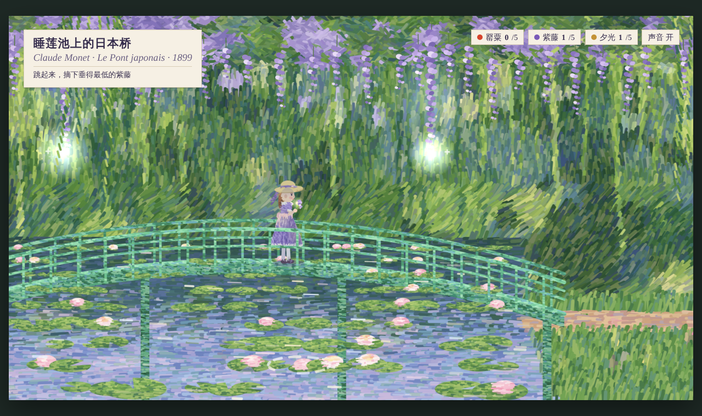
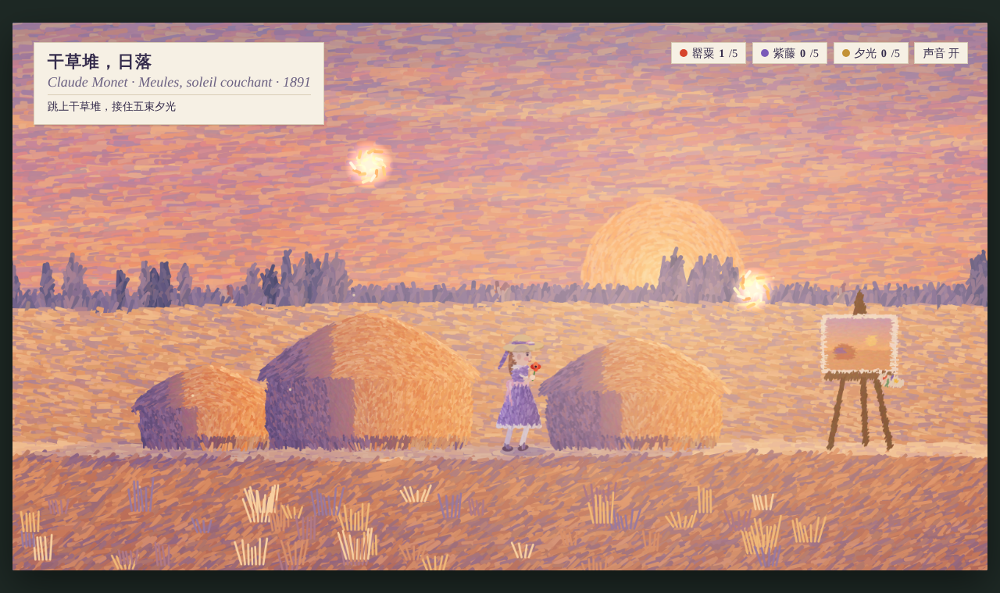

# A Walk in Monet's Garden · Promenade chez Monet

[中文](README.md) | English

A small side-scrolling browser game. A little girl in a purple dress walks into three of Monet's paintings, gathering glowing poppies, wisteria and evening light along the way. When she reaches the easel, her walk becomes a painting.

**▶ Play online: https://jojoxiaojing.github.io/monet-skill-game/**

> **Made with the [huashu-art-motion](https://github.com/alchaincyf/huashu-art-motion) skill.**
> The skill is by Huashu ([@alchaincyf](https://github.com/alchaincyf)) and paints animation in many art styles with code. The game's Monet brushwork, and its structure of a character walking left to right through one painting after another, both come from it.

## The three paintings

| Painting | Year | What to collect |
|---|---|---|
| Poppy Field (Les Coquelicots) | 1873 | Five glowing poppies. Walk up to one and she bends down to pick it. |
| The Japanese Footbridge (Le Pont japonais) | 1899 | Five low-hanging wisteria sprigs. She has to jump to reach them. |
| Haystacks at Sunset (Meules, soleil couchant) | 1891 | Five rays of evening light. Some need a jump from the top of a haystack. |

## How to play

- Keyboard: `←` `→` or `A` `D` to walk, `Space` or `↑` to jump.
- Phone: hold the arrow buttons below the game to walk, tap 「跳」 to jump. It looks best in landscape.

Open `index.html` in a browser and play. Nothing to install. The whole game is a single HTML file with no image assets; every frame is painted in code.

The in-game text is in Chinese. The labels name each painting in Chinese and French, and the counters at the top right track poppies (罂粟), wisteria (紫藤) and evening light (夕光).

## What the game uses from the skill

- **The Monet recipe** (`references/风格配方/28_monet.md`): paint a flat underlayer first, then repaint it with short strokes drawn from a palette for each region. Water gets horizontal strokes, grass gets vertical ones, and distant houses get a second pass with a finer brush.
- **Stroke repainting with a fixed seed per cell** (`XING.strokes` in `demos/long_scroll/lib/crossing.js`): each stroke stays in place, so the picture doesn't flicker from frame to frame.
- **The long-scroll structure** (`references/11-长卷穿越片.md`): each painting is a long horizontal scroll. At each boundary, the next painting covers the last one stroke by stroke.
- **The painting stays alive**: light glints on the water, lily pads bob in the ripples, willow and wisteria sway, and poppies bend aside as she walks through them.
- **The character shares the painting's style** (`references/角色精细度.md`): the girl is painted with the same Monet strokes. A cool violet shadow falls under her hat brim, and the sunset painting tints her warm.

## Credits

- Painting method and structure: [huashu-art-motion](https://github.com/alchaincyf/huashu-art-motion) by Huashu
- Inspired by Claude Monet's *Poppy Field*, *The Japanese Footbridge* and his *Haystacks* series
- Game made by Claude using the skill above
